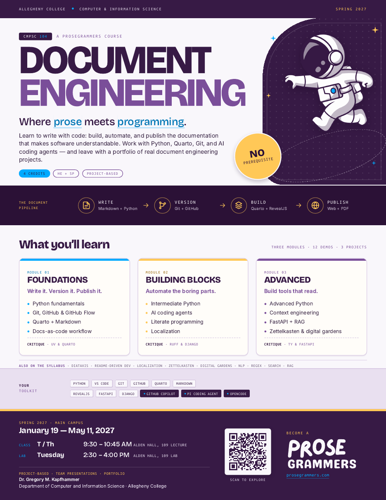
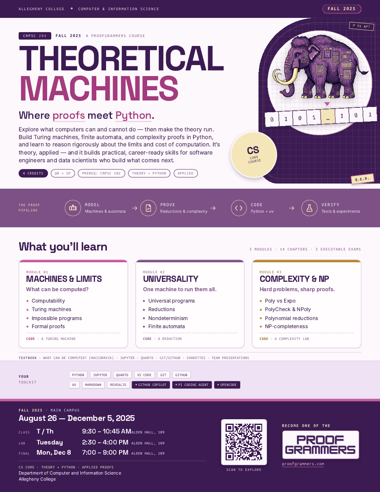
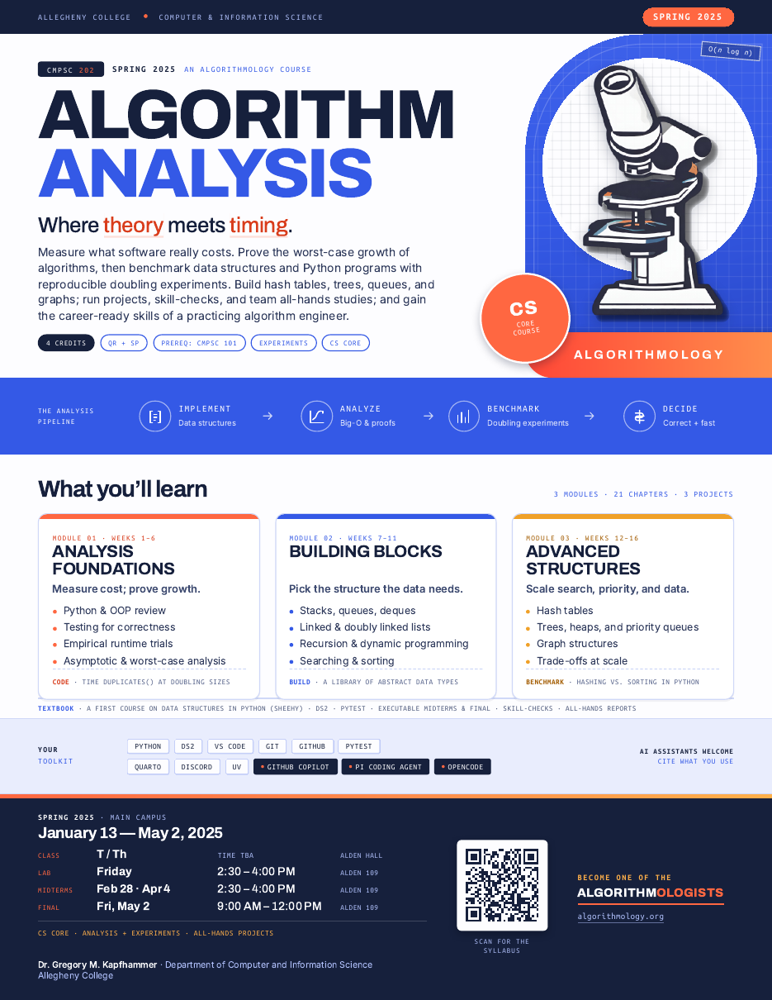
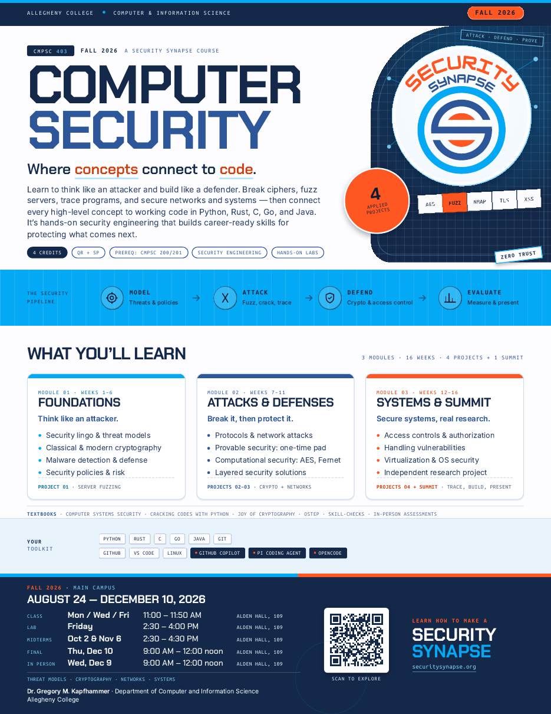
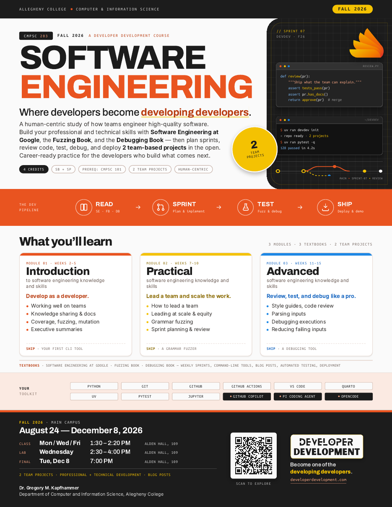

# Course Advertisement Posters

Print-ready promotional posters for courses in the **Department of Computer and
Information Science at Allegheny College**.

A growing series: each poster is a self-contained HTML/CSS document with local
fonts and artwork, rendered to a US Letter PDF and a 300 DPI PNG. The HTML is
the editable source; the PDF and PNG are committed so a poster can be printed
or shared immediately.

## Poster gallery

| Document Engineering | Theoretical Machines |
| --- | --- |
|  |  |
| **CMPSC 104 · Spring 2027** | **CMPSC 204 · Fall 2025** |

| Algorithmology | Computer Security |
| --- | --- |
|  |  |
| **CMPSC 202 · Spring 2025** | **CMPSC 403 · Fall 2026** |

| Developer Development | More to come |
| --- | --- |
|  | *New course posters are added here as they are scheduled.* |
| **CMPSC 203 · Fall 2026** | |

## Posters

| Course | Brand | Term | Deliverables |
| --- | --- | --- | --- |
| [CMPSC 104 — Document Engineering](document-engineering/) | Prosegrammers | Spring 2027 | [PDF](document-engineering/CMPSC104-Document-Engineering-Spring2027.pdf) · [PNG](document-engineering/CMPSC104-Document-Engineering-Spring2027.png) |
| [CMPSC 204 — Theoretical Machines](proofgrammers/) | Proofgrammers | Fall 2025 | [PDF](proofgrammers/CMPSC204-Theoretical-Machines-Fall2025.pdf) · [PNG](proofgrammers/CMPSC204-Theoretical-Machines-Fall2025.png) |
| [CMPSC 202 — Algorithm Analysis](algorithmology/) | Algorithmology | Spring 2025 | [PDF](algorithmology/CMPSC202-Algorithmology-Spring2025.pdf) · [PNG](algorithmology/CMPSC202-Algorithmology-Spring2025.png) |
| [CMPSC 403 — Computer Security](security-synapse/) | Security Synapse | Fall 2026 | [PDF](security-synapse/CMPSC403-Security-Synapse-Fall2026.pdf) · [PNG](security-synapse/CMPSC403-Security-Synapse-Fall2026.png) |
| [CMPSC 203 — Software Engineering](developer-development/) | Developer Development | Fall 2026 | [PDF](developer-development/CMPSC203-Developer-Development-Fall2026.pdf) · [PNG](developer-development/CMPSC203-Developer-Development-Fall2026.png) |

The series spans document engineering (Python, Quarto, docs-as-code),
theoretical machines (computability, Turing machines, complexity), algorithm
analysis (asymptotics, benchmarking, data structures), computer security
(cryptography, malware, network attacks, secure systems), and software
engineering (professional skills, testing, debugging, and team projects).

## Repository layout

```text
course-advertisement-posters/
├── README.md
├── AGENTS.md
├── .gitignore
├── algorithmology/
├── developer-development/
├── document-engineering/
├── proofgrammers/
└── security-synapse/
```

Each course folder is self-contained:

```text
<course>/
├── README.md
├── poster.html
├── build.sh
├── <course>-<term>.pdf
├── <course>-<term>.png
├── preview.png
└── assets/
```

`build/` is generated by the build script and ignored by git. The final PDF,
final PNG, and preview are committed.

**Agent instructions:** read [AGENTS.md](AGENTS.md) before editing a poster,
adding a course, or changing the build workflow.

## Design system

The series shares a reusable structure: US Letter portrait, blocks A–F, a
full-bleed dark footer, Inter for body copy, Ubuntu Mono for labels, and a
committed PDF/PNG pair. Each course chooses its own display face and palette:

| Course | Display | Palette |
| --- | --- | --- |
| Document Engineering | Bricolage Grotesque | Plum `#371a45`, violet `#7a4e99`, blue `#00aaff`, gold `#ffc857` |
| Theoretical Machines | Space Grotesk | Aubergine `#3b1b52`, mauve `#7e5186`, orchid `#c85a9e`, ivory `#f4e6b8` |
| Algorithmology | Archivo | Navy `#16203c`, blue `#3459e6`, coral `#ff6741`, amber `#ffb04a` |
| Computer Security | Chakra Petch | Navy `#14294a`, blue `#2e5799`, cyan `#03a9f4`, orange `#ff5722` |
| Developer Development | Archivo | Orange `#e95420`, charcoal `#1c1c1c`, off-white `#fafafa`, gold `#f4c202`, code blue `#1e88e5` |

- **Body:** Inter
- **Labels / code:** Ubuntu Mono
- **Format:** US Letter portrait, 8.5 × 11 in
- **Outputs:** vector PDF + 300 DPI PNG (2550 × 3300 px)

Fonts are stored locally in each poster’s `assets/fonts/` directory so builds
are reproducible offline. See the font notes in each course folder for licenses.

## Building a poster

Each course folder has its own `build.sh`:

```bash
./algorithmology/build.sh
./developer-development/build.sh
./document-engineering/build.sh
./proofgrammers/build.sh
./security-synapse/build.sh
```

The script uses headless Chromium and `pdftoppm`. It writes intermediates to
`build/` (ignored by git) and copies the final PDF, PNG, and preview to the
course folder root.

## Adding a new poster

1. Read [AGENTS.md](AGENTS.md) for the design system, layout constraints, and
   QA checklist.
2. Copy an existing course folder as a starting point:

   ```bash
   cp -r document-engineering new-course-name
   # or: cp -r proofgrammers new-course-name
   # or: cp -r algorithmology new-course-name
   # or: cp -r security-synapse new-course-name
   # or: cp -r developer-development new-course-name
   ```

3. Rename the PDF and PNG to match the new course and term.
4. Edit `poster.html`; the copy is grouped into blocks **A–F** with comments.
5. Replace the artwork in `assets/` as needed.
6. Update the course `README.md`, this README’s gallery/table/design system,
   and the root `AGENTS.md` if the workflow changes.
7. Run `./new-course-name/build.sh` and check the PDF/PNG.
8. Commit the source, assets, final PDF, final PNG, and preview.

## Schedule notes

- **Algorithmology:** the site does not publish a Tuesday/Thursday class time,
  so the poster prints “T / Th” with a time TBA. Its Friday lab and midterms
  use 2:30–4:00 PM; exams are in Alden 109. The README documents the
  assumptions.
- **Computer Security:** the poster uses the instructor-confirmed
  Monday/Wednesday/Friday 11:00–11:50 AM class and Friday 2:30–4:00 PM lab.
  The public syllabus cadence differs, so reconfirm against the registrar
  before printing.
- **Developer Development:** the poster uses the site’s Mon/Wed/Fri
  1:30–2:20 PM class and Wednesday 2:30–4:00 PM lab, with the final on Tuesday,
  December 8, 2026 at 7:00 PM. The final-exam room is not published; the poster
  uses Alden Hall, 109 and the README flags it for confirmation.

## Assets and licensing

- The poster fonts are open-source: Bricolage Grotesque, Space Grotesk,
  Archivo, Chakra Petch, and Inter under the SIL Open Font License 1.1, and
  Ubuntu Mono under the Ubuntu Font Licence 1.0. License links live in each
  course’s `assets/fonts/README.md`.
- Course artwork is taken from the respective course brands: Prosegrammers,
  Proofgrammers, Algorithmology, Security Synapse, and Developer Development.
- QR codes are generated with [Segno](https://segno.readthedocs.io/).
- No repository-wide license has been added yet; add one before accepting
  outside reuse.
