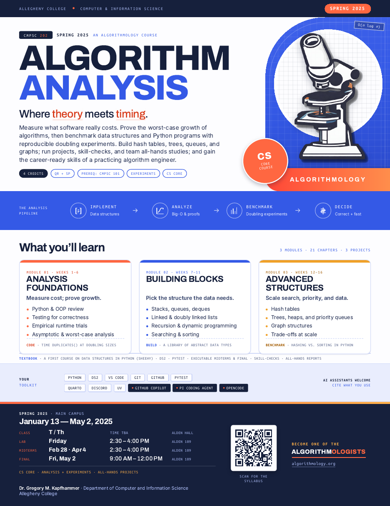

# Algorithmology — Spring 2025 poster

A print-ready promotional poster for **CMPSC 202: Algorithm Analysis** — the
**Algorithmology** course — at Allegheny College. US Letter, portrait, built
from a single editable HTML file.



## Files

| File | What it is |
| --- | --- |
| `poster.html` | **The source.** All copy, layout, and styling live here. |
| `build.sh` | Renders the poster to PDF and PNG. |
| `CMPSC202-Algorithmology-Spring2025.pdf` | **Final print-ready PDF** (US Letter, 612 × 792 pt). |
| `CMPSC202-Algorithmology-Spring2025.png` | **Final 300 DPI PNG** (2550 × 3300 px). |
| `preview.png` | Smaller PNG for quick sharing and README previews. |
| `assets/` | Fonts, microscope mascot, logo, and QR code. |
| `build/` | Generated intermediates (ignored by git). |

## Preview and rebuild

Open `poster.html` in a browser to preview it.

From this directory:

```bash
./build.sh
```

From the repository root:

```bash
./algorithmology/build.sh
```

The script uses headless Chromium and `pdftoppm`. It writes the PDF, 300 DPI
PNG, and preview into `build/`, then copies the final deliverables to this
folder with course-specific filenames.

## Course snapshot

- **Course:** CMPSC 202 — Algorithm Analysis
- **Brand:** Algorithmology
- **Term and dates:** Spring 2025, January 13 — May 2, 2025
- **Class:** Tuesday / Thursday (published class time: **not stated** — the
  poster prints “time TBA”)
- **Lab:** Friday, 2:30 – 4:00 PM
- **Midterm exams:** Friday, February 28 and Friday, April 4, 2025,
  2:30 – 4:00 PM, Alden 109
- **Final exam:** Friday, May 2, 2025, 9:00 AM – 12:00 noon, Alden 109
- **Credits:** 4
- **Prerequisite:** CMPSC 101
- **Distribution requirements:** QR, SP
- **Role:** core course in the Computer Science major
- **Structure:** 3 modules, 21 chapters, 3 algorithm all-hands projects
- **Instructor:** Dr. Gregory M. Kapfhammer
- **Course site:** <https://algorithmology.org/>

### Facts, sources, and assumptions

Verified against the course site (Spring 2025 edition):

- `/syllabus/`: instructor, office (Alden 108), prerequisite CMPSC 101,
  distribution requirements QR + SP, “core course in the Computer Science
  major,” assessment split (skill-checks, projects, all-hands, midterms, final),
  textbook *A First Course on Data Structures in Python* and the `ds2` package.
- `/schedule/`: module weeks and chapters (1–6, 7–11, 12–16; chapters 1–5,
  6–14, 15–21), the Tuesday/Thursday class and Friday lab cadence, the
  midterm and final exam dates, times, and room (Alden 109), and the
  all-hands project phases.
- `/slides/`: weekly topics from algorithm analysis and Python through graphs.
- Allegheny College catalog entry: 4 credits; core course in the major.

Flagged on purpose:

- **Class time is not published.** The schedule names Tuesday and Thursday
  sessions but gives no clock time, so the poster prints **“T / Th” + “time
  TBA”** rather than an invented time. The 2:30 – 4:00 PM slot is documented
  for the **Friday lab** and the two midterms, which are held in the lab
  period; it is not presented as the class time.
- **Class room is not published.** The poster uses **“Alden Hall”** for the
  class row because the instructor’s office and every published exam room are
  in Alden Hall. Only the lab and exams are confirmed as **Alden 109**.
- **Spring 2025 is the last edition.** If the poster is reused for a later
  offering, update the term, dates, exam schedule, and instructor.

## Giving feedback

The poster is divided into labelled blocks, both in the HTML comments and in
the page structure:

- **A — Top bar:** college, department, term.
- **B — Hero:** course code, title, tagline, intro, badges, microscope mascot,
  coral Algorithmology band, “CS core” sticker.
- **C — Pipeline:** implement → analyze → benchmark → decide.
- **D — What you’ll learn:** the 3 module cards and the textbook line.
- **E — Toolkit:** tools and AI coding agents.
- **F — Schedule / CTA:** dates, class, lab, midterms, final, QR, wordmark.

“Change the intro in block B” is enough to point at the right place. If you
edit it yourself, most text is plain HTML in the corresponding block.

## Copy notes

- Use numerals for counts on the poster: **3 modules**, **21 chapters**,
  **3 projects**.
- The CTA is plural: **“Become one of the Algorithmologists.”** The hero band
  and kicker carry the **Algorithmology** brand name.
- Keep **Spring 2025** bold and visible in the top bar, hero kicker, and footer.
- Stress both halves of the course: **asymptotic analysis** (worst-case
  proofs) and **empirical benchmarking** (doubling experiments in Python).
- The toolkit lists **GitHub Copilot**, **Pi Coding Agent**, and **OpenCode**.
  Gemini CLI is deprecated and should not be added back.

## Design notes

- **Palette:** navy ink `#16203c`, brand blue `#3459e6` (from the site’s
  navbar), coral `#ff6741` and amber `#ffb04a` (from the logo’s coral band),
  paper `#fdfdff` (the site background), lavender `#e9edfd`.
- **Display:** Archivo; **body:** Inter; **labels/code:** Ubuntu Mono.
- **Artwork:** the microscope mascot is cropped from the site logo
  (`https://algorithmology.org/images/Algorithmology-Logo.svg`); the full logo
  tile is kept as `assets/algorithmology-logo.png` for reference.
- **QR:** generated with Segno for <https://algorithmology.org/>, error
  correction H, 2-module quiet zone.

## Notes

- Fonts are local in `assets/fonts/`; see `assets/fonts/README.md` for licenses.
- For professional printing, print the PDF at 100% (“actual size”) on US
  Letter. The blue arch and dark footer are full-bleed; a borderless printer
  gives the cleanest edges, but important text stays inside the margins.
