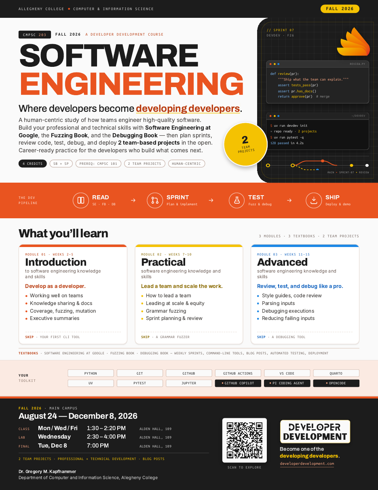

# Software Engineering — Fall 2026 poster

A print-ready promotional poster for **CMPSC 203: Software Engineering** — the
**Developer Development** course — at Allegheny College. US Letter, portrait,
built from a single editable HTML file.



## Files

| File | What it is |
| --- | --- |
| `poster.html` | **The source.** All copy, layout, and styling live here. |
| `build.sh` | Renders the poster to PDF and PNG. |
| `CMPSC203-Developer-Development-Fall2026.pdf` | **Final print-ready PDF** (US Letter, 612 × 792 pt). |
| `CMPSC203-Developer-Development-Fall2026.png` | **Final 300 DPI PNG** (2550 × 3300 px). |
| `preview.png` | Smaller PNG for quick sharing and README previews. |
| `assets/` | Fonts, logo artwork, and the QR code. |
| `build/` | Generated intermediates (ignored by git). |

## Preview and rebuild

Open `poster.html` in a browser to preview it.

From this directory:

```bash
./build.sh
```

From the repository root:

```bash
./developer-development/build.sh
```

The script uses headless Chromium and `pdftoppm`. It writes the PDF, 300 DPI
PNG, and preview into `build/`, then copies the final deliverables to this
folder with descriptive filenames.

## Course snapshot

- **Course:** CMPSC 203 — Software Engineering
- **Brand:** Developer Development (<https://www.developerdevelopment.com/>)
- **Department:** Computer and Information Science, Allegheny College
- **Term:** Fall 2026, Main Campus
- **Dates:** August 24 — December 8, 2026
- **Class:** Monday, Wednesday, Friday, 1:30 – 2:20 PM, Alden Hall, 109
- **Lab:** Wednesday, 2:30 – 4:00 PM, Alden Hall, 109
- **Final exam:** Tuesday, December 8, 2026, 7:00 PM, Alden Hall, 109
- **Instructor:** Dr. Gregory M. Kapfhammer
- **Credits:** 4
- **Prerequisite:** CMPSC 101
- **Distribution requirements:** SB, SP
- **Textbooks:** *Software Engineering at Google* (SE), *Fuzzing Book* (FB),
  *Debugging Book* (DB)
- **Structure:** 3 modules, 2 major team projects, weekly executive summaries
  and command-line tools
- **Module 1:** Introduction to software engineering knowledge and skills —
  weeks 2–5
- **Module 2:** Practical software engineering knowledge and skills — weeks 7–10
- **Module 3:** Advanced software engineering knowledge and skills — weeks 11–15
- Week 1 is onboarding; weeks 6, 11, and 16 are assessment weeks.

### Sources and assumptions

- Course facts, module names, week ranges, and the weekly cadence come from the
  course site: <https://www.developerdevelopment.com/>,
  <https://www.developerdevelopment.com/syllabus/>, and
  <https://www.developerdevelopment.com/schedule/>.
- Credits (4), the CMPSC 101 prerequisite, and the SB/SP distribution
  requirements match the Allegheny College 2026–2027 Academic Bulletin entry
  for CMPSC 203.
- Fall 2026 dates follow the Registrar's calendar: first day of class August 25,
  a sixteen-week term through the December 7–10 examination period. The poster
  uses the site's week-one start of **August 24, 2026**.
- The schedule page lists the final examination as **Tuesday, December 8, 2026
  at 7:00 PM** (exam code F). One heading on that page says "Wednesday"; the
  date and the Registrar's calendar both give Tuesday.
- **The final-examination room is not stated on the site.** The poster uses
  Alden Hall, 109 — the lecture and laboratory room — and should be confirmed
  with the Registrar before printing.

## Giving feedback

The poster is divided into labelled blocks, both in the HTML comments and in the
page structure:

- **A — Top bar:** college, department, term.
- **B — Hero:** course code, title, tagline, intro, badges, editor panel with
  code/terminal windows, commit graph, fan mark, "2 team projects" sticker.
- **C — Pipeline:** read → sprint → test → ship.
- **D — What you'll learn:** the 3 module cards and textbook line.
- **E — Toolkit:** tools and AI coding agents.
- **F — Schedule / CTA:** dates, times, final exam, instructor, QR, wordmark.

"Change the intro in block B" is enough to point at the right place. If you edit
it yourself, most text is plain HTML in the corresponding block.

## Copy notes

- Use numerals for counts on the poster: **3 modules**, **3 textbooks**,
  **2 team projects**.
- The CTA is plural: **"Become one of the developing developers."**
- Keep **Fall 2026** bold and visible in the top bar, hero kicker, and footer.
- Stress the human-centric, professional-plus-technical framing: teams, sprint
  planning, executive summaries and blog posts, command-line tools, code
  review, testing, debugging, and deployment.
- The toolkit lists **GitHub Copilot**, **Pi Coding Agent**, and **OpenCode**.
  Gemini CLI is deprecated and should not be added back.
- Name Dr. Gregory M. Kapfhammer; he is teaching this edition.

## Design notes

- **Palette:** orange `#e95420`, charcoal `#1c1c1c`, off-white `#fafafa`, gold
  `#f4c202`, code blue `#1e88e5`, plus an orange tint `#fbeae2` for the toolkit.
- **Display:** Archivo; **body:** Inter; **labels/code:** Ubuntu Mono.
- **Artwork:** the Developer Development horizontal logo
  (`assets/Developer-Development-Horizontal-Logo.svg`) supplies the footer
  wordmark (`assets/devdev-wordmark.svg`, a viewBox crop of the lockup); the
  favicon mark (`assets/devdev-logo-favicon.svg`) is the fan-shaped "missing
  piece" D in the hero panel. Both are taken from the course site.
- **QR:** generated with Segno for <https://www.developerdevelopment.com/>,
  error correction H, 2-module quiet zone, dark `#1c1c1c` on `#fafafa`.

Regenerate the QR with:

```bash
uv run --with segno python - <<'PY'
import segno
qr = segno.make("https://www.developerdevelopment.com/", error="h")
qr.save("assets/qr-devdev.svg", kind="svg", scale=1, border=2,
        dark="#1c1c1c", light="#fafafa")
qr.save("assets/qr-devdev.png", kind="png", scale=14, border=2,
        dark="#1c1c1c", light="#fafafa")
PY
```

## QA

- PDF: 1 page, 612 × 792 pt.
- PNG: 2550 × 3300 px at 300 DPI; fonts embedded (Archivo appears as Type 3
  because it is a variable font — it prints correctly).
- The QR decodes from the rendered 300 DPI PNG, not just the asset.
- Blocks A–F fit 11.00 in with no clipped cards, text, or footer.

## Notes

- Fonts are local in `assets/fonts/`; see `assets/fonts/README.md` for licenses.
- For professional printing, print the PDF at 100% ("actual size") on US
  Letter. The dark panel and footer are full-bleed; a borderless printer gives
  the cleanest edges, but important text stays inside the margins.
