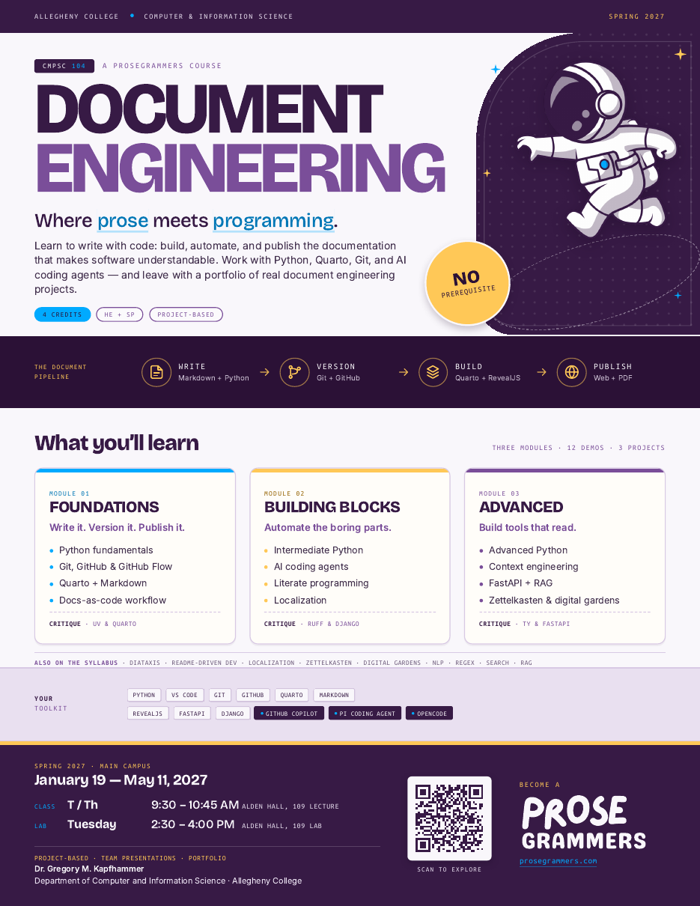

# Document Engineering — Spring 2027 poster

A print-ready promotional poster for **CMPSC 104: Document Engineering** at
Allegheny College. US Letter, portrait, built from a single editable HTML file.



## Files

| File | What it is |
| --- | --- |
| `poster.html` | **The source.** All copy, layout, and styling live here. |
| `build.sh` | Renders the poster to PDF and PNG. |
| `CMPSC104-Document-Engineering-Spring2027.pdf` | **Final print-ready PDF** (US Letter, 612 × 792 pt). |
| `CMPSC104-Document-Engineering-Spring2027.png` | **Final 300 DPI PNG** (2550 × 3300 px). |
| `preview.png` | Smaller PNG for quick sharing and README previews. |
| `assets/` | Fonts, astronaut/wordmark SVGs, and the QR code. |
| `build/` | Generated intermediates (ignored by git). |

## Preview and rebuild

Open `poster.html` in a browser to preview it.

From this directory:

```bash
./build.sh
```

From the repository root:

```bash
./document-engineering/build.sh
```

The script uses headless Chromium and `pdftoppm`. It writes the PDF, 300 DPI
PNG, and preview into `build/`, then copies the final deliverables to this
folder with descriptive filenames.

## Giving feedback

The poster is divided into labelled blocks, both in the HTML comments and in
the page structure:

- **A — Top bar:** college, department, term.
- **B — Hero:** course code, title, tagline, intro, badges, astronaut,
  “no prerequisite” sticker.
- **C — Pipeline:** write → version → build → publish.
- **D — What you’ll learn:** the three module cards.
- **E — Toolkit:** tools and AI coding agents.
- **F — Schedule / CTA:** dates, times, rooms, instructor, QR, wordmark.

“Change the intro in block B” is enough to point at the right place. If you
edit it yourself, most text is plain HTML in the corresponding block.

## Feedback checklist

A quick way to review a draft:

- Does the title and one-line pitch read the way you want?
- Are the three module headings and bullets the right emphasis?
- Is the astronaut / “no prerequisite” sticker balance right?
- Are the schedule, room, dates, and instructor details exact?
- Is the amount of copy about right for a printed letter poster?

## Common edits

- **Colors:** the `:root` block at the top of `poster.html` (brand plum,
  violet, paper, blue, gold).
- **Title size:** `.hero h1` (`font-size: 63pt`).
- **Course details:** block F, plus the “Spring 2027” labels in blocks A and B.
- **Three module cards:** block D; each card has its own `MODULE` label,
  heading, promise, bullets, and critique line.
- **QR code:** replace `assets/qr-prosegrammers.svg` with a new QR SVG, or
  regenerate with `segno` for another URL.
- **AI tools:** the toolkit currently lists GitHub Copilot, Pi Coding Agent,
  and OpenCode. Update the three `chip hot` entries in block E if that changes.
- **Photos/art:** the astronaut is `assets/astronaut.svg`; the footer wordmark
  is `assets/wordmark-light.svg`. Both are extracted from the course logo.

## Notes

- Fonts are stored locally in `assets/fonts/`, so the poster renders the same
  offline and in print. See `assets/fonts/README.md` for licenses.
- The QR code points to <https://prosegrammers.com/>.
- The course website still mentions Gemini CLI in its own copy; the poster
  intentionally lists **Pi Coding Agent** instead, per the current toolset.
- The design uses the course site’s palette (`#371a45`, `#7a4e99`, `#f9f7fb`,
  `#00aaff`) plus gold for the sticker and accents.
- The astronaut and Prosegrammers wordmark are course branding taken from the
  course logo.
- For professional printing, print the PDF at 100% (“actual size”) on US
  Letter. The dark arch and footer are full-bleed; a borderless printer gives
  the cleanest edges, but the important text stays well inside the margins.
