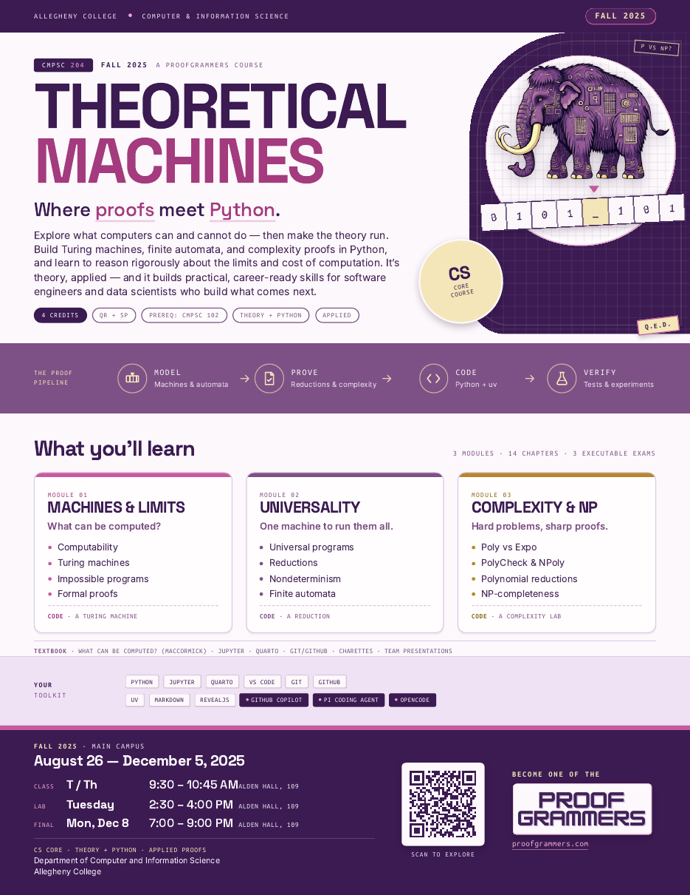

# Theoretical Machines — Fall 2025 poster

A print-ready promotional poster for **CMPSC 204: Theoretical Machines** — the
**Proofgrammers** course — at Allegheny College. US Letter, portrait, built from
a single editable HTML file.



## Files

| File | What it is |
| --- | --- |
| `poster.html` | **The source.** All copy, layout, and styling live here. |
| `build.sh` | Renders the poster to PDF and PNG. |
| `CMPSC204-Theoretical-Machines-Fall2025.pdf` | **Final print-ready PDF** (US Letter, 612 × 792 pt). |
| `CMPSC204-Theoretical-Machines-Fall2025.png` | **Final 300 DPI PNG** (2550 × 3300 px). |
| `preview.png` | Smaller PNG for quick sharing and README previews. |
| `assets/` | Fonts, elephant/wordmark artwork, and the QR code. |
| `build/` | Generated intermediates (ignored by git). |

## Preview and rebuild

Open `poster.html` in a browser to preview it.

From this directory:

```bash
./build.sh
```

From the repository root:

```bash
./proofgrammers/build.sh
```

The script uses headless Chromium and `pdftoppm`. It writes the PDF, 300 DPI
PNG, and preview into `build/`, then copies the final deliverables to this
folder with descriptive filenames.

## Course snapshot

- **Course:** CMPSC 204 — Theoretical Machines
- **Brand:** Proofgrammers
- **Term and dates:** Fall 2025, August 26 — December 5, 2025
- **Class:** Tuesday / Thursday, 9:30 – 10:45 AM, Alden Hall, 109
- **Lab:** Tuesday, 2:30 – 4:00 PM, Alden Hall, 109
- **Final exam:** Monday, December 8, 2025, 7:00 – 9:00 PM, Alden Hall, 109
- **Credits:** 4
- **Prerequisite:** CMPSC 102 or permission of instructor
- **Distribution requirements:** QR, SP
- **Textbook:** *What Can Be Computed?* by John MacCormick
- **Structure:** 3 modules, 14 chapters, 3 executable exams
- **Instructor:** intentionally not named on this poster; the course is
  advertised with the department. Add the next instructor when known. The
  owner is **not** teaching the next offering, so do not add his name.

**Note:** this poster uses the **last edition’s Fall 2025 dates and times** at
the owner’s request. If it is reused for a later offering, update the term,
dates, final exam, and instructor. Confirm the class/lab room with the
registrar before printing.

## Giving feedback

The poster is divided into labelled blocks, both in the HTML comments and in
the page structure:

- **A — Top bar:** college, department, term.
- **B — Hero:** course code, title, tagline, intro, badges, elephant, Turing
  tape, CS core sticker.
- **C — Pipeline:** model → prove → code → verify.
- **D — What you’ll learn:** the 3 module cards and textbook line.
- **E — Toolkit:** tools and AI coding agents.
- **F — Schedule / CTA:** dates, times, final exam, department, QR, wordmark.

“Change the intro in block B” is enough to point at the right place. If you
edit it yourself, most text is plain HTML in the corresponding block.

## Copy notes

- Use numerals for counts on the poster: **3 modules**, **14 chapters**,
  **3 executable exams**.
- The wordmark is plural: **“Become one of the Proofgrammers.”**
- Keep **Fall 2025** bold and visible in the top bar, hero kicker, and footer.
- Stress that the course is theoretical but applied: Python implementations,
  proofs, experiments, and career-ready skills for software engineers and data
  scientists.
- The toolkit lists **GitHub Copilot**, **Pi Coding Agent**, and **OpenCode**.
  Gemini CLI is deprecated and should not be added back.
- Do not name an instructor unless the current instructor is confirmed.

## Design notes

- **Palette:** aubergine `#3b1b52`, mauve `#7e5186`, orchid `#c85a9e`,
  orchid-deep `#a33b7e`, lavender `#efe2f4`, cream `#fdf8fc`, ivory `#f4e6b8`.
- **Display:** Space Grotesk; **body:** Inter; **labels/code:** Ubuntu Mono.
- **Artwork:** `assets/elephant.png` and `assets/wordmark.png` are extracted
  from the Proofgrammers course logo; `assets/proofgrammers-logo.png` is the
  original reference.
- **QR:** generated with Segno for <https://proofgrammers.com/>, error
  correction H, 2-module quiet zone.

## Notes

- Fonts are local in `assets/fonts/`; see `assets/fonts/README.md` for licenses.
- For professional printing, print the PDF at 100% (“actual size”) on US
  Letter. The dark arch and footer are full-bleed; a borderless printer gives
  the cleanest edges, but important text stays inside the margins.
