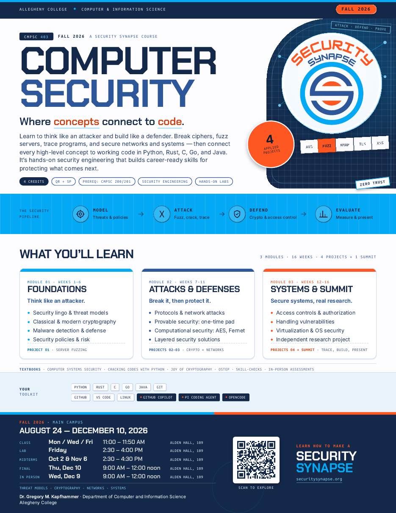

# Computer Security — Fall 2026 poster

A print-ready promotional poster for **CMPSC 403: Computer Security** — the
**Security Synapse** course — at Allegheny College. US Letter, portrait, built
from a single editable HTML file.



## Files

| File | What it is |
| --- | --- |
| `poster.html` | **The source.** All copy, layout, and styling live here. |
| `build.sh` | Renders the poster to PDF and PNG with headless Chromium + `pdftoppm`. |
| `CMPSC403-Security-Synapse-Fall2026.pdf` | **Final print-ready PDF** (US Letter, 612 × 792 pt, 1 page). |
| `CMPSC403-Security-Synapse-Fall2026.png` | **Final 300 DPI PNG** (2550 × 3300 px). |
| `preview.png` | Smaller PNG (110 DPI) for quick sharing and README previews. |
| `assets/` | Fonts, the Security Synapse logo, and the QR code. |
| `build/` | Generated intermediates (ignored by git). |

## Preview and rebuild

Open `poster.html` in a browser to preview it.

From this directory:

```bash
./build.sh
```

From the repository root:

```bash
./security-synapse/build.sh
```

The script uses headless Chromium and `pdftoppm`. It writes the PDF, 300 DPI
PNG, and preview into `build/`, then copies the final deliverables to this
folder with descriptive filenames.

Regenerate the QR code (needs `uv`):

```bash
./assets/make-qr.sh
```

## Course snapshot

- **Course:** CMPSC 403 — Computer Security
- **Brand:** Security Synapse
- **Department:** Computer and Information Science, Allegheny College
- **Term:** Fall 2026, Main Campus
- **Dates:** August 24 — December 10, 2026 (Week 1 through Week 16)
- **Class:** Monday / Wednesday / Friday, 11:00 – 11:50 AM, Alden Hall, 109
- **Lab:** Friday, 2:30 – 4:00 PM, Alden Hall, 109
- **Midterm executable exams:** Friday, October 2 and Friday, November 6,
  2026, 2:30 – 4:30 PM, Alden 109
- **Final executable exam:** Thursday, December 10, 2026, 9:00 AM – 12:00 noon,
  Alden 109 (exam code J)
- **Final in-person assessment:** Wednesday, December 9, 2026,
  9:00 AM – 12:00 noon, Alden 109
- **Instructor:** Dr. Gregory M. Kapfhammer (Alden Hall 108)
- **Credits:** 4
- **Prerequisite:** CMPSC 200 or CMPSC 201
- **Distribution requirements:** QR, SP
- **Structure:** 3 modules, 16 weeks, 4 security survey projects, 1 security
  summit project
- **Textbooks:** *Computer Systems Security: Planning for Success*,
  *Cracking Codes with Python*, *The Joy of Cryptography*,
  *Operating Systems: Three Easy Pieces*
- **Tools:** Python, Rust, C, Go, Java, Linux, Git, GitHub, VS Code,
  GitHub Copilot, Pi Coding Agent, OpenCode
- **Course site:** <https://www.securitysynapse.org/>
- **Syllabus:** <https://www.securitysynapse.org/syllabus/>
- **Schedule:** <https://www.securitysynapse.org/schedule/>
- **Projects:** <https://www.securitysynapse.org/projects/>
- **Slides:** <https://www.securitysynapse.org/slides/>

## Fact sources and assumptions

Checked against the course site on November 17, 2026:

- **Credits (4), QR + SP, and the prerequisite (CMPSC 200 or CMPSC 201)** come
  from the syllabus.
- **Module topics, projects, assessment types, and the date ranges** come from
  the syllabus, schedule, and projects pages. The three module cards follow the
  schedule’s module highlights: Basics of Computer Security (weeks 1–6),
  Challenges and Solutions (weeks 7–11), and Advanced Topics (weeks 12–16).
- **Midterm, final, and in-person assessment dates and times** (including
  Alden 109) come from the schedule’s “Important Dates” section. Midterms and
  the final are executable exams; the December 9 session is the final in-person
  assessment.
- **Weekly class time:** the site does not publish the weekly meeting time for
  Fall 2026. The poster uses **Monday / Wednesday / Friday, 11:00 – 11:50 AM**,
  as confirmed by the course instructor for this offering. Reconfirm it against
  the registrar before printing.
- **Lab time:** the poster shows **Friday, 2:30 – 4:00 PM** (the lab slot), as
  confirmed by the instructor. The schedule publishes midterm examinations in
  the same slot running **2:30 – 4:30 PM**; the poster keeps those exam times
  separate and labeled.
- **Room:** the site publishes Alden 109 for the lab, both midterms, the final,
  and the in-person assessment; the poster uses **Alden Hall, 109** for every
  scheduled session, as directed by the instructor. The syllabus lists the
  instructor’s office as Alden Hall 108.
- **Instructor:** Dr. Gregory M. Kapfhammer is teaching this Fall 2026
  offering, per the syllabus.

## Giving feedback

The poster is divided into labelled blocks, both in the HTML comments and in
the page structure:

- **A — Top bar:** college, department, term.
- **B — Hero:** course code, title, tagline, intro, badges, Security Synapse
  logo, tool tape, stickers.
- **C — Pipeline:** model → attack → defend → evaluate.
- **D — What you’ll learn:** the 3 module cards and the textbook line.
- **E — Toolkit:** languages, tools, and AI coding agents.
- **F — Schedule / CTA:** dates, class/lab/exam times, QR, wordmark.

“Change the intro in block B” is enough to point at the right place. If you
edit it yourself, most text is plain HTML in the corresponding block.

## Copy notes

- Use numerals for counts on the poster: **3 modules**, **16 weeks**,
  **4 projects**, **1 summit**.
- Footer CTA: **“Learn how to make a”** followed by the **Security Synapse** wordmark.
- Keep **Fall 2026** bold and visible in the top bar, hero kicker, and footer.
- The toolkit lists **GitHub Copilot**, **Pi Coding Agent**, and **OpenCode**.
  Gemini CLI is deprecated and should not be added back.
- The schedule separates the Friday lab (2:30 – 4:00 PM) from the executable
  midterm exams that run in the same slot (2:30 – 4:30 PM).

## Design notes

- **Palette:** navy `#14294a`, logo blue `#2e5799`, site cyan `#03a9f4`,
  logo orange `#ff5722`, orange deep `#cf3d0c`, mist `#e8f2fb`,
  paper `#fdfdff` — all drawn from securitysynapse.org and its logo.
- **Display:** Chakra Petch (700/600/500); **body:** Inter;
  **labels/code:** Ubuntu Mono (400/700).
- **Artwork:** `assets/security-synapse-logo.svg` is the course logo from
  <https://www.securitysynapse.org/images/Security-Synapse-Logo.svg>. The
  arch, synapse network, tool tape, and stamps are drawn in HTML/CSS/SVG.
- **QR:** generated with Segno for <https://www.securitysynapse.org/>,
  error correction H, 2-module quiet zone, navy-on-paper; written to
  `assets/qr-securitysynapse.svg` and `.png` by `assets/make-qr.sh`.

## Verification

- PDF: 1 page, 612 × 792 pt (US Letter).
- PNG: 2550 × 3300 px at 300 DPI; `preview.png` at 110 DPI.
- Fonts: embedded in the PDF (Chakra Petch, Inter, Ubuntu Mono).
- QR: decodes from the rendered 300 DPI PNG and from `preview.png` to
  `https://www.securitysynapse.org/`.
- Layout: blocks A–F total exactly 11.00 in; no clipped text or footer
  overflow at print size.

## Notes

- Fonts are local in `assets/fonts/`; see `assets/fonts/README.md` for
  licenses.
- For professional printing, print the PDF at 100% (“actual size”) on US
  Letter. The top bar, pipeline, and footer are full-bleed; a borderless
  printer gives the cleanest edges, but important text stays inside the
  margins.
